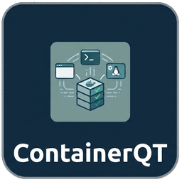

<p align="center"></p>

# ContainerQT Studio

**A desktop app for developing inside Docker.** Pick a Linux distribution, click once, and get a ready-to-use
environment: a build window for packaging (AppImage, `.deb`, RPM and more), a desktop you can look at like a VM,
drag-and-drop file import, and one-click export of your results back to your computer.

> **Containers are not virtual machines.** They share your computer's kernel and have weaker isolation than a VM.
> Use ContainerQT Studio with software and files you trust. See [Security and limits](docs/wiki/Security-and-Limits.md).

## Why use it

- **Test your software on the Linux you ship for**, without installing it: Ubuntu, Debian, Fedora, Rocky/Alma, Arch,
  openSUSE, Alpine, Kali, or any Docker image.
- **Build packages in a clean, matching environment**: an AppImage on an old glibc, a `.deb` on Debian, an RPM on Rocky.
- **Try the same app on different desktops**: KDE Plasma 5 vs 6, GNOME, XFCE, Cinnamon, MATE, i3, Sway and more.
- **Repeat yourself less**: save a known-good setup as a template, a build as a profile, an environment as a clone.
- **Keep your system drive free**: park environments on any Linux-formatted drive, or use a throw-away one that leaves nothing behind.

## How it works in 60 seconds

1. Open the **Environments** tab, choose a Linux, a desktop (or none), and whether to keep it (*persistent*) or discard it (*one-time*).
2. Check the suggested **CPU/memory** (they adapt to your machine) and press **Create environment**.
3. Bring your project in on the **Files** tab, pick a script on the **Build** tab and run it, then **Export** the result.
4. Switch to the **Desktop** tab whenever you want to see and use the environment's desktop.

## What's inside

| Tab | Purpose |
|---|---|
| **Environments** | Create, start, stop, restart, snapshot, rebuild, clone, resize, health-check, fix and delete environments |
| **Templates** | Save and recreate known-good setups (built-ins include KDE Plasma 5 and 6 variants) |
| **Build** | Ready-made packaging scripts, your own scripts, reusable build profiles |
| **Desktop** | The environment's desktop embedded in the window (noVNC) |
| **Files** | Drag-and-drop import, export to your computer |
| **Log** | Everything that happened, with a failures-only view |

Also: a **Fix** button that repairs Docker and your environments, a **compatibility check** before building, a
**health check** per environment, and a hardware-aware **resource advisor**. It *advises*; you decide.

## Install

**AppImage** (glibc 2.34 or newer: Ubuntu 22.04+, Debian 12+, Fedora 35+, RHEL/Rocky/Alma 9+, Arch, openSUSE):

```bash
chmod +x ContainerQT-*.AppImage && ./ContainerQT-*.AppImage
```

It needs Docker on your computer (the **Fix** button can install and start it for you) and FUSE 2 to run
(`libfuse2` / `fuse-libs`; otherwise add `--appimage-extract-and-run`).

**From source**

```bash
python3 -m venv .venv && . .venv/bin/activate
pip install -e '.[desktop,dev]'   # 'desktop' adds the embedded desktop view
python -m containerqt
```

Building the AppImage yourself: [Building the AppImage](docs/wiki/Building-the-AppImage.md).

## Typical workflows

| I want to... | Do this |
|---|---|
| Ship an AppImage that runs on older distros | Ubuntu 22.04 environment, *AppImage* build script, export |
| Check my KDE app on Plasma 5 and Plasma 6 | Two templates (`KDE-Qt5`, `KDE-Qt6`), open each one's Desktop tab |
| Produce `.deb`, `.rpm` and Arch packages | One environment per format, one build profile each |
| Try something risky-ish but trusted, once | One-time environment, import, test, export, stop |
| Keep a long-lived dev box off my SSD | Persistent environment on a second drive |

More in [Workflows](docs/wiki/Workflows.md).

## Documentation

The README is the short version. The **[wiki](docs/wiki/Home.md)** has the detail:

[Getting started](docs/wiki/Getting-Started.md) ·
[Environments](docs/wiki/Environments.md) ·
[Desktops and compositors](docs/wiki/Desktops-and-Compositors.md) ·
[Storage: persistent vs one-time](docs/wiki/Storage.md) ·
[Resources](docs/wiki/Resources.md) ·
[Templates](docs/wiki/Templates.md) ·
[Build window and profiles](docs/wiki/Build-Window.md) ·
[Files: import and export](docs/wiki/Files.md) ·
[Health, compatibility and Fix](docs/wiki/Health-Compatibility-and-Fix.md) ·
[Workflows](docs/wiki/Workflows.md) ·
[Security and limits](docs/wiki/Security-and-Limits.md) ·
[Troubleshooting](docs/wiki/Troubleshooting.md) ·
[Building the AppImage](docs/wiki/Building-the-AppImage.md) ·
[Architecture (for contributors)](docs/wiki/Architecture.md)

(The `docs/wiki` folder can be pushed as-is to the project's GitHub wiki.)

## Good to know

- **Not a VM.** No VM-level isolation; trusted sources only.
- **The `docker` group is root-equivalent** on the host. That is how Docker works, not specific to ContainerQT Studio.
- **One-time environments** discard the environment's own data, but Docker still keeps images, layers, cache and logs.
- **Alpine** uses musl: fine to build *in*, but an AppImage for glibc hosts should be built in a glibc environment.
- **Persistent environments need their drive mounted.** ContainerQT Studio refuses to start one without it.

## Project layout

```
containerqt/          the app (core logic, hardware/, docker/, gui/)
containerqt/resources/ container entrypoint, desktop session, storage scripts, pkexec helper + polkit policy, icons
packaging/           AppImage build
tests/               automated tests (core, desktops, storage, resources, templates, checks, headless GUI)
docs/wiki/           in-depth documentation
```

The Python package and command are `containerqt`; the app is called ContainerQT Studio. For compatibility with existing installs, saved settings and data keep their original `dockerqt` names (`~/.config/dockerqt`, the `DockerQT` storage folders, the `.dockerqt-env` marker, the privileged helper and polkit action).

## License

No `LICENSE` file is included yet. Add the one you want (and set `project_license` in
`packaging/io.github.bobbycomet.dockerqt.metainfo.xml`).
